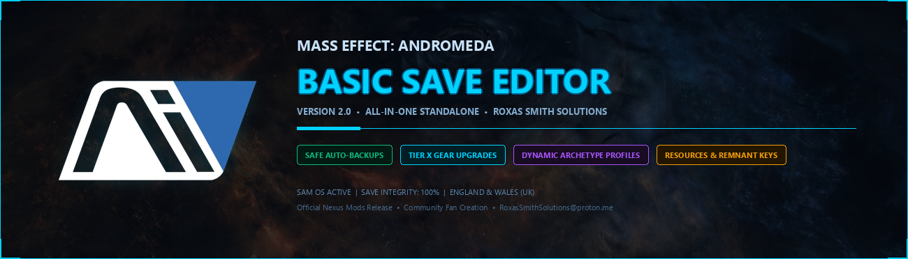
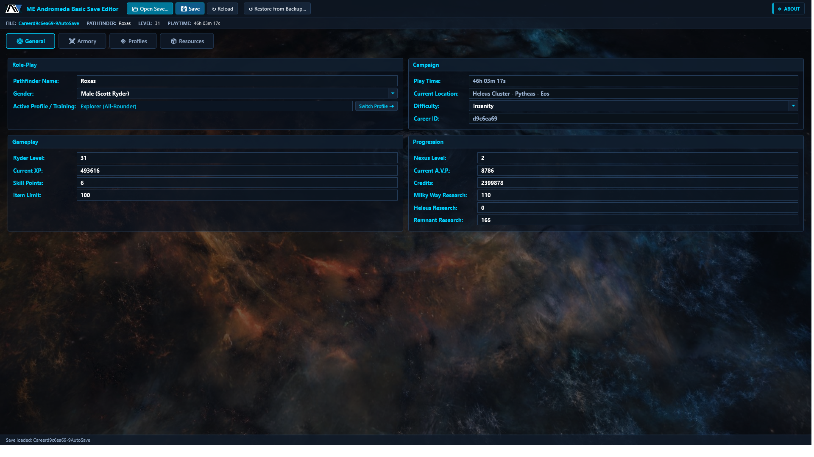
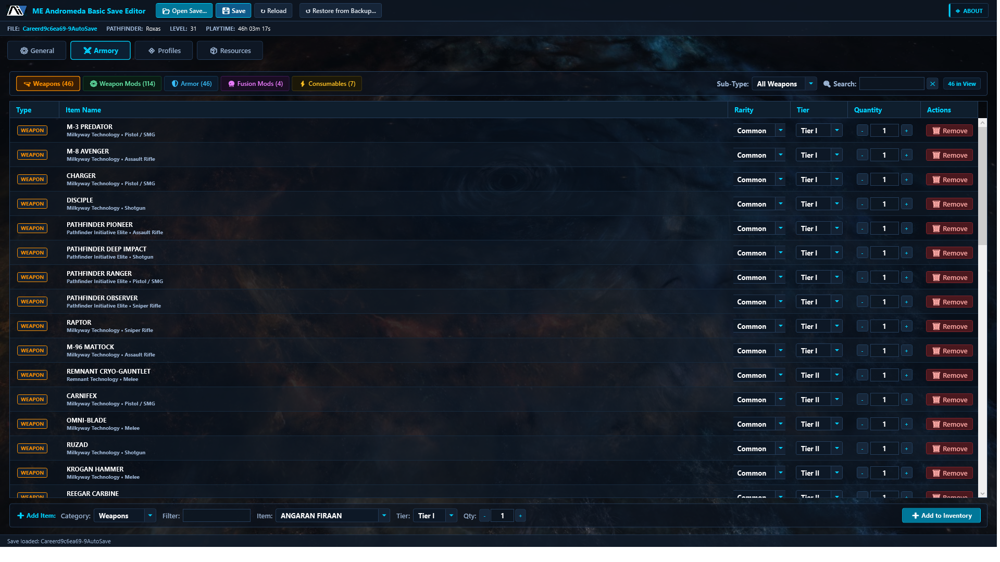
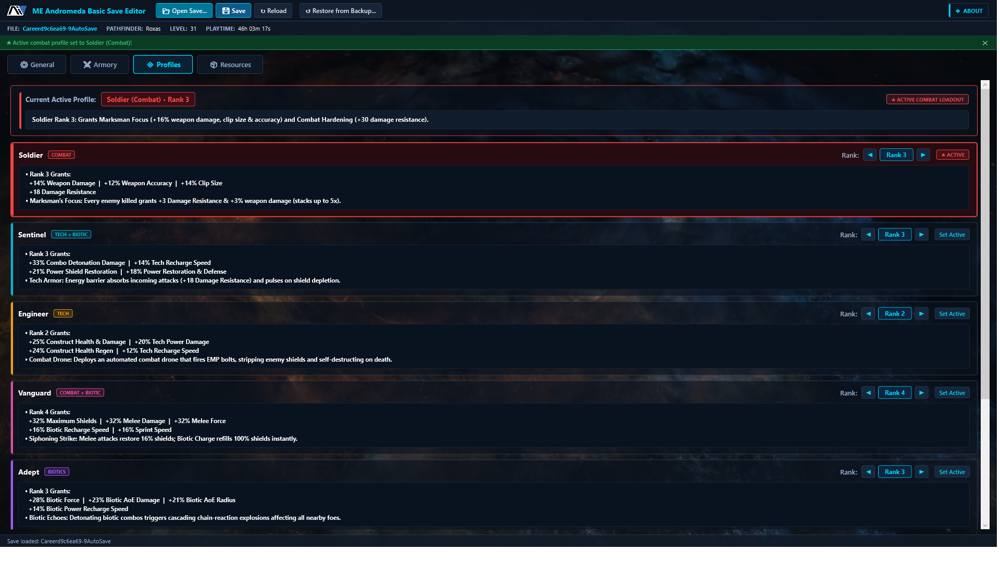
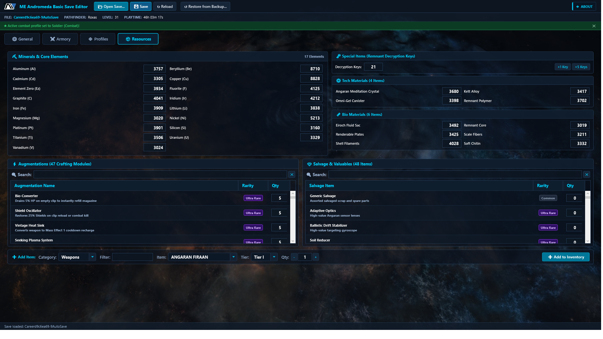

# Mass Effect Andromeda Basic Save Editor



A modern, standalone, zero-risk save editor for **Mass Effect: Andromeda** single-player campaigns. Developed by **RoxasSmithSolutions (RSS)**.

---

## ⚡ Overview

**Mass Effect Andromeda Basic Save Editor** gives you complete control over your single-player journey through the Heleus Cluster. Featuring automated pre-save safety backups, an authentic Andromeda SAM-HUD interface, 1-click Tier X armory upgrades, and dynamic combat profile archetype theming, it provides a safe, seamless, and intuitive editing experience.

---

## 📸 Screenshots

| General (Progression & Stats) | Armory (Weapons & Tier X Upgrades) |
| :---: | :---: |
|  |  |

| Profiles (Dynamic Archetype Theming) | Resources & Remnant Decryption Keys |
| :---: | :---: |
|  |  |

---

## 🌟 Key Features

* **🛡️ Zero-Risk Automated Safety Backups:**
  * Timestamped snapshots are created automatically every time you click **Save** (before any changes are written) in:
    `Documents\BioWare\Mass Effect Andromeda\Save\ME Andromeda Save Editor Backup\`
  * Instant 1-click rollbacks via the built-in **`↺ Restore from Backup...`** toolbar.
* **👤 Campaign & Role-Play Customization:**
  * Pathfinder Name, Gender (Scott / Sara), Campaign Difficulty, and accurate in-game Planet/Starship locations.
  * Ryder Level (1–132), XP, unallocated Skill Points, Credits, Nexus Level, and A.V.P.
  * Milky Way, Heleus, and Remnant Research Data.
  * Inventory capacity management (100 base, 150 with Trade Capacity I, 200 with Trade Capacity II).
* **⚔️ Armory & Instant Tier X Upgrades:**
  * Browse and organize Weapons, Weapon Mods, Armor, Fusion Mods, and Consumables.
  * Upgrade any weapon or armor piece to **Tier X (Max Tier)** in a single click.
  * Add any authentic single-player item directly to your inventory.
* **💠 Dynamic Combat Profiles & Perks:**
  * **Dynamic Archetype Illumination:** Activating a profile lights up the loadout card in that profile's signature archetype color (Soldier Red, Sentinel Teal, Engineer Amber, Vanguard Magenta, Adept Purple, Infiltrator Orange, Explorer Cyan).
  * Interactive steppers (`◀ Rank 1 to 6 ▶`) calculate and display scaled passive combat bonuses and recharge times in real time.
* **📦 Crafting Resources & Decryption Keys:**
  * Edit quantities for all 17 core minerals (Element Zero, Platinum, Iron, Nickel, Titanium, etc.).
  * Set bio and tech crafting materials (Angaran Meditation Crystals, Remnant Polymer, Kett Alloys, etc.).
  * Add Remnant Decryption Keys to instantly bypass alien monolith glyph puzzles.

---

## 🛠️ Building from Source

### Prerequisites
* Windows 10 or Windows 11 (64-bit)
* [.NET Framework 4.8 Developer Pack](https://dotnet.microsoft.com/en-us/download/dotnet-framework/net48)
* [.NET SDK](https://dotnet.microsoft.com/en-us/download) (version 6.0, 7.0, 8.0, or newer)

### Build Steps
1. Clone the repository:
   ```bash
   git clone https://github.com/RoxasSmithSolutions/Mass-Effect-Andromeda-Save-Editor.git
   cd Mass-Effect-Andromeda-Save-Editor
   ```
2. Build the project using .NET CLI:
   ```bash
   dotnet build MEABasicSaveEditor.csproj -c Release
   ```
3. The standalone, all-in-one executable will be generated at:
   ```text
   bin\Release\net48\ME Andromeda Basic Save Editor.exe
   ```

---

## 📄 License & Legal Notice

This software is an independent, non-commercial fan creation provided free of charge for the *Mass Effect: Andromeda* gaming and modding community. This project is not affiliated with, endorsed by, or sponsored by Electronic Arts Inc. or BioWare.

Governed by the **RoxasSmithSolutions (RSS) Community Software License v2.0** under the laws of England and Wales (United Kingdom). See [`LICENSE.txt`](LICENSE.txt) for full terms.

---

## 🙏 Acknowledgements

* **Rick Gibbed (gibbed):** For the inspiration to create a dedicated save editor for *Mass Effect: Andromeda* following his legendary Trilogy Save Editor for ME 1–3.
* **BioWare & Electronic Arts:** For creating the *Mass Effect* universe.
* The Mass Effect modding community for their continued support.
